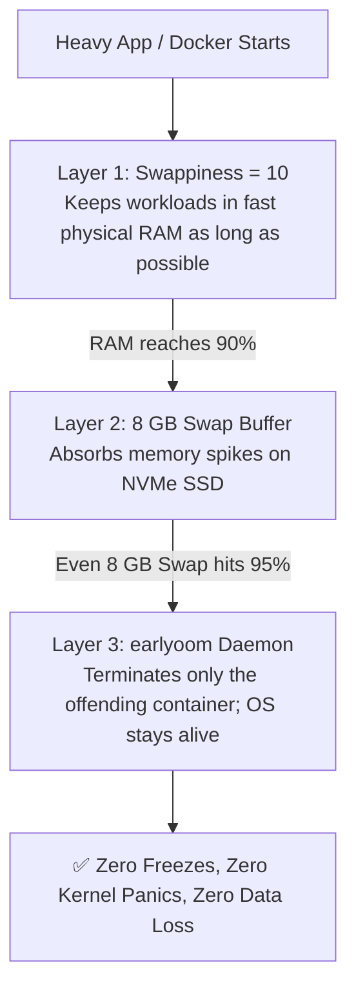

# Kali Linux Stability & Memory Crash Fix Guide

This guide details how to diagnose, check system specs, and configure the **3-layer memory defense system** to prevent Kali Linux from freezing, suffering Buffer I/O errors, or crashing with **Kernel Panic (`Attempted to kill init! exitcode=0x0000000b`)** when running resource-heavy workloads like Docker containers (e.g., Oracle DB) on laptops with **Core i3 / 8 GB RAM / 256 GB NVMe SSD**.

---

## 1. How to Check System Specs & Kali OS Version

Open your terminal in Kali and run these commands to inspect your operating system and hardware profile:

### Check Kali OS Version & Build
```bash
cat /etc/os-release
```
*Look for `VERSION` and `VERSION_ID`.*

### Pretty Hardware & System Summary
```bash
fastfetch
# or if not installed:
# sudo apt install -y fastfetch && fastfetch
```
*Displays OS version, active kernel, CPU model, desktop environment, and RAM usage.*

### Individual Hardware Checks
| Component | Command | Expected / Example Output |
| :--- | :--- | :--- |
| **Kernel Version** | `uname -r` | `7.2.15+kali-amd64` |
| **CPU Model** | `lscpu \| grep "Model name"` | `11th Gen Intel(R) Core(TM) i3-...` |
| **RAM & Swap** | `free -h` | Total RAM (e.g., ~7.5G) and Swap size |
| **SSD & Partitions**| `lsblk -o NAME,SIZE,FSTYPE,MOUNTPOINT` | Shows your NVMe disk partitions (`nvme0n1p1`, `nvme0n1p2`) |

---

## 2. Root Cause Analysis

When running heavy server containers (such as Oracle Database `ORCLCDB` with SGA/PGA), total memory consumption easily exceeds **6 GB to 8 GB**. 

* **Why it panics without fixes:**
  1. Default Swap is too small (~1.6 GB).
  2. Available RAM drops to ~0%.
  3. The kernel runs out of memory addresses and triggers a `SIGSEGV (0x0b)` memory fault.
  4. The Out-Of-Memory condition terminates `PID 1` (`systemd`), causing an unrecoverable **Kernel Panic**.
  5. Sudden hard power cut causes **dirty bits** and **Buffer I/O errors** on the NVMe SSD.

---

## 3. The 3-Layer Defense Solution

Apply these 3 layers to make Kali Linux resilient and immune to memory starvation.



---

### Layer 1: Expand Swap Buffer to 8 GB (Like Windows Pagefile)

Creating an 8 GB swap file on your NVMe SSD ensures your system has a large virtual memory cushion ($7.5\text{ GB RAM} + 8\text{ GB Swap} = 15.5\text{ GB}$ total addressable memory).

```bash
# 1. Turn off old swap
sudo swapoff -a

# 2. Allocate an 8 GB file on root
sudo fallocate -l 8G /swapfile

# 3. Restrict permissions (root only)
sudo chmod 600 /swapfile

# 4. Format as swap
sudo mkswap /swapfile

# 5. Enable the swap file
sudo swapon /swapfile

# 6. Make permanent in /etc/fstab (only add if not already present)
sudo grep -qxF '/swapfile none swap sw 0 0' /etc/fstab || echo '/swapfile none swap sw 0 0' | sudo tee -a /etc/fstab
```

---

### Layer 2: Install and Enable `earlyoom` (The Circuit Breaker)

`earlyoom` monitors available memory 10 times per second. If free RAM drops below 5%, it safely terminates the single process consuming the most RAM (e.g., Java/Oracle/Docker) **before** the Linux kernel panics.

```bash
# 1. Update package database and install earlyoom
sudo apt update && sudo apt install earlyoom -y

# 2. Enable and start earlyoom service
sudo systemctl enable --now earlyoom
```

#### (Optional) Custom tuning for developer containers:
Edit `/etc/default/earlyoom`:
```bash
sudo nano /etc/default/earlyoom
```
Set:
```text
EARLYOOM_ARGS="-m 5 -s 10 -r 60 --prefer '^(java|oracle|dockerd)' --avoid '^(systemd|Xorg|lightdm|xfce4.*)'"
```
Restart earlyoom:
```bash
sudo systemctl restart earlyoom
```

---

### Layer 3: Optimize Swappiness (`vm.swappiness = 10`)

By default, Linux moves idle memory to swap too aggressively (`swappiness=60`). Lowering it to `10` forces Linux to prioritize fast physical RAM and only use the SSD swap when physical RAM is genuinely running out.

```bash
# 1. Apply immediately
sudo sysctl vm.swappiness=10

# 2. Persist across reboots in sysctl config
sudo grep -qxF 'vm.swappiness=10' /etc/sysctl.conf || echo 'vm.swappiness=10' | sudo tee -a /etc/sysctl.conf
```

---

## 4. Verification Checklist

Run these commands to confirm that all 3 protections are actively working:

### 1. Verify Swap is Active and Sized at ~8 GB
```bash
free -h
```
*Check the `Swap:` row. Total should display around `8.0Gi`.*

### 2. Verify `earlyoom` is Active
```bash
systemctl status earlyoom
```
*Status should show `active (running)` in green.*

### 3. Verify Swappiness Value
```bash
cat /proc/sys/vm/swappiness
```
*Should output `10`.*

### 4. Verify System Services Health
```bash
systemctl --failed
```
*Should output: `0 loaded units listed.`*

---

## 5. Docker Best Practice for 8 GB Laptops

To avoid auto-start memory spikes during boot:

### Keep Docker Manual on Boot
```bash
sudo systemctl disable docker
sudo systemctl disable docker.socket
sudo systemctl disable containerd
```

### Start Docker Only When Needed
```bash
sudo systemctl start docker
```

### Stop Docker When Finished
```bash
sudo systemctl stop docker
```

### Always Set Memory Limits on Containers
Never start containers without a hard ceiling:
```bash
docker run -d \
  --name oracle-db \
  -m 3g \
  --memory-swap 4g \
  -p 1521:1521 \
  your-oracle-image
```
